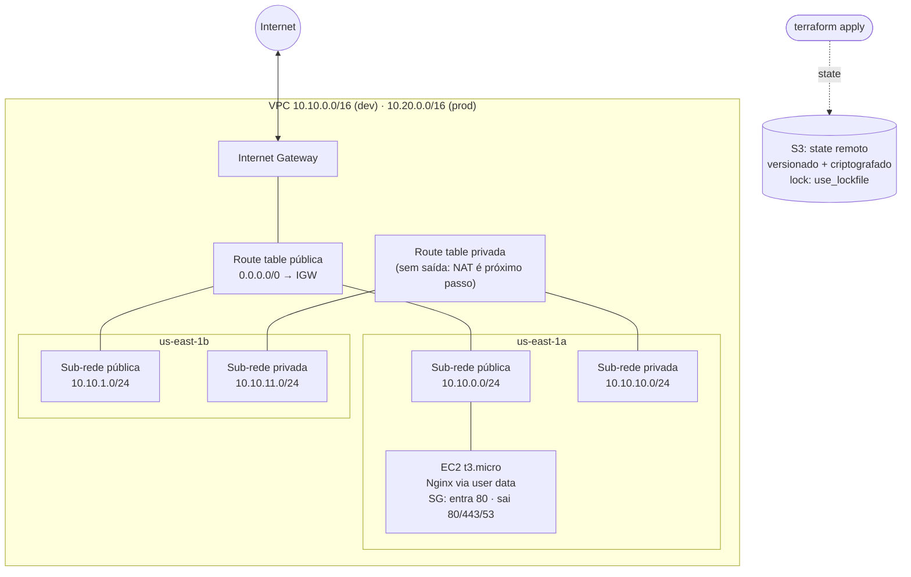

# terraform-aws-vpc-ec2

[](https://github.com/lucas-neme/terraform-aws-vpc-ec2/actions/workflows/ci.yml)


> **English summary:** A beginner-friendly Terraform project that builds a small but correct AWS network:
> a VPC with public and private subnets across 2 AZs, an Internet Gateway, route tables, a minimal security
> group and an EC2 instance that installs Nginx through user data. It uses reusable modules (`network`,
> `compute`), validated variables, `dev`/`prod` environments and an S3 remote backend with native locking.
> Everything runs for free against **LocalStack** by default; the README also shows the optional path to real
> AWS. CI runs `terraform fmt`, `validate`, `terraform test`, `tflint` and `checkov`.

## Objetivo

Praticar, de forma simples e limpa, o básico de **infraestrutura como código** na AWS:
rede (VPC, sub-redes, rotas), computação (EC2), segurança mínima (security group, IMDSv2, disco criptografado),
organização em **módulos**, **ambientes** separados e **state remoto com lock**.
Tudo roda no seu computador com o LocalStack, sem conta da AWS e sem custo.

## Arquitetura



### Estrutura

```text
.
├── bootstrap/              # cria o bucket S3 do state (roda uma vez, state local)
├── modules/
│   ├── network/            # VPC, sub-redes, IGW, route tables, SG default fechado
│   └── compute/            # security group, regras, EC2 + user data (Nginx)
├── envs/
│   ├── dev/                # terraform.tfvars + backend.hcl (LocalStack)
│   ├── prod/               # idem, com outra faixa de rede e outra chave de state
│   └── aws-real.backend.hcl.example   # backend da AWS real, comentado
├── tests/main.tftest.hcl   # terraform test com provider simulado (offline)
├── scripts/smoke.sh        # confere pela API do LocalStack o que foi criado
├── main.tf variables.tf locals.tf outputs.tf providers.tf backend.tf versions.tf
├── docker-compose.yml      # LocalStack 4.14
├── Makefile                # atalhos: make help
└── .github/workflows/ci.yml
```

## Pré-requisitos

| Ferramenta | Versão usada | Para quê |
|---|---|---|
| Linux, macOS ou WSL2 | — | `make` e scripts bash |
| [Terraform](https://developer.hashicorp.com/terraform/install) | 1.17 (mín. 1.10) | o projeto |
| Docker + Docker Compose | 24+ | rodar o LocalStack |
| [AWS CLI v2](https://docs.aws.amazon.com/cli/latest/userguide/getting-started-install.html) | 2.x | só para `make smoke` |
| [tflint](https://github.com/terraform-linters/tflint) e [checkov](https://www.checkov.io/) | 0.66 / 3.4 | só para `make test` |

> **Por que LocalStack 4.14 e não `latest`?** Desde 2026 a imagem `latest` do LocalStack exige token de licença.
> A 4.14 é a última edição comunitária que sobe sem conta, por isso a versão está fixada no `docker-compose.yml`.

## Como rodar (LocalStack, custo zero)

```bash
git clone https://github.com/lucas-neme/terraform-aws-vpc-ec2.git
cd terraform-aws-vpc-ec2

make up            # sobe o LocalStack e cria o bucket do state (bootstrap)
make apply         # init com backend S3 + plan + apply do ambiente dev
make smoke         # confere VPC, 4 sub-redes, IGW, EC2 com IMDSv2 e o state no S3
make destroy       # destrói o ambiente
make down          # apaga o bucket do state e desliga o LocalStack
```

Ambiente prod: `make apply ENV=prod`, `make smoke ENV=prod`, `make destroy ENV=prod`.

Verificações sem LocalStack (as mesmas do CI):

```bash
make test          # fmt + validate + tflint + checkov + terraform test
```

Comandos "na mão", sem make:

```bash
terraform init -backend-config=envs/dev/backend.hcl
terraform plan  -var-file=envs/dev/terraform.tfvars -out=dev.tfplan
terraform apply dev.tfplan
terraform destroy -var-file=envs/dev/terraform.tfvars
```

> No LocalStack a EC2 é **simulada**: ela aparece como `running` na API, mas não boota um Linux de verdade,
> então o Nginx do user data só responde na AWS real. O objetivo aqui é validar a infraestrutura.

## Caminho opcional: AWS real

Só faça isso se quiser ver o Nginx no navegador. **Sempre termine com `terraform destroy`.**

**Custo estimado** (us-east-1, preços on-demand de referência; confira na
[calculadora da AWS](https://calculator.aws/)):

| Recurso | Custo aproximado |
|---|---|
| EC2 t3.micro | ~US$ 0,0104/hora (~US$ 7,60/mês ligada direto) |
| IPv4 público | ~US$ 0,005/hora (~US$ 3,60/mês) |
| EBS gp3 8 GB | ~US$ 0,64/mês |
| VPC, sub-redes, IGW, route tables, SG | sem custo |
| S3 do state | centavos |
| **Teste de 1 hora** | **menos de US$ 0,05** |

Contas novas da AWS têm free tier/créditos (as regras mudaram em 2025; confira no console a sua situação).
Crie um alerta de orçamento (AWS Budgets) antes de começar.

```bash
# 1. credenciais de um usuário IAM (nunca da conta root)
aws configure

# 2. bucket de state com nome único
terraform -chdir=bootstrap init
terraform -chdir=bootstrap apply -var use_localstack=false -var force_destroy=false \
  -var state_bucket_name=tfstate-SEU-NOME-vpc-ec2

# 3. backend real
cp envs/aws-real.backend.hcl.example envs/aws-real.backend.hcl   # descomente e ajuste o bucket
terraform init -reconfigure -backend-config=envs/aws-real.backend.hcl

# 4. apply sem LocalStack e com a AMI Ubuntu 24.04 oficial (ami_id = null)
terraform apply -var environment=dev -var vpc_cidr=10.10.0.0/16 -var use_localstack=false
curl "$(terraform output -raw web_url)"

# 5. SEMPRE no fim
terraform destroy -var environment=dev -var vpc_cidr=10.10.0.0/16 -var use_localstack=false
```

## Decisões principais

| Decisão | Por quê |
|---|---|
| Módulos `network` e `compute` | separa responsabilidades e permite reaproveitar a rede com outra aplicação |
| `for_each` por AZ nas sub-redes | mudar a ordem da lista não recria sub-redes (com `count` recriaria) |
| Variáveis com `validation` | o erro aparece no `plan`, antes de criar qualquer coisa (ex.: tipo de máquina caro) |
| State remoto no S3 + `use_lockfile` | state seguro, versionado, compartilhado e com lock nativo (Terraform 1.10+, sem DynamoDB) |
| Um `backend.hcl` e um `.tfvars` por ambiente | o mesmo código serve dev e prod; muda só a configuração |
| Sub-redes privadas sem NAT | NAT Gateway custa ~US$ 32/mês; fica como próximo passo |
| IMDSv2 obrigatório e disco criptografado | proteções baratas contra SSRF e vazamento de dados |
| SG com saída restrita (80/443/53) e SSH fechado | princípio do menor privilégio |
| `default_tags` no provider | todo recurso sai com Project/Environment/ManagedBy (custo rastreável) |
| Exceções do checkov comentadas em `.checkov.yaml` | cada risco aceito fica explícito e justificado |

## Testes e CI

- `terraform test` (`tests/main.tftest.hcl`): 6 cenários com **provider simulado** (`mock_provider`), offline:
  CIDRs das sub-redes, faixa do prod, validações que precisam falhar (ambiente, tipo de instância, máscara da VPC)
  e o módulo compute exigindo IMDSv2, disco criptografado e SSH fechado.
- `scripts/smoke.sh`: depois do apply no LocalStack, confere tudo pela API (aws cli).
- GitHub Actions: `terraform fmt -check`, `validate`, `terraform test`, `tflint` (com o ruleset da AWS) e `checkov`.

## O que eu aprendi

- O **state** é a memória do Terraform: perdeu, o Terraform "esquece" o que criou. Por isso remoto, versionado e com lock.
- O backend não aceita variáveis; a saída é a **configuração parcial** (`-backend-config`).
- O bucket do state precisa existir antes do `init`: o **bootstrap** separado resolve o "ovo e a galinha".
- `for_each` com chave estável evita recriações; `count` é melhor só para "liga/desliga" (como a regra de SSH).
- `terraform test` com `mock_provider` testa a lógica do código em segundos, sem nuvem.
- Ferramentas de análise (tflint, checkov) acham problemas que o `validate` não vê; aceitar um risco é ok, desde que justificado.

## Próximos passos

- NAT Gateway (ou NAT instance) para dar saída às sub-redes privadas.
- Application Load Balancer na frente e EC2 na sub-rede privada (remove o IP público).
- IAM role com SSM Session Manager no lugar de SSH.
- VPC Flow Logs no CloudWatch.
- Pipeline de `plan` comentando no PR e `apply` com aprovação manual (OIDC, sem chave fixa no GitHub).

## Licença

[MIT](LICENSE)
